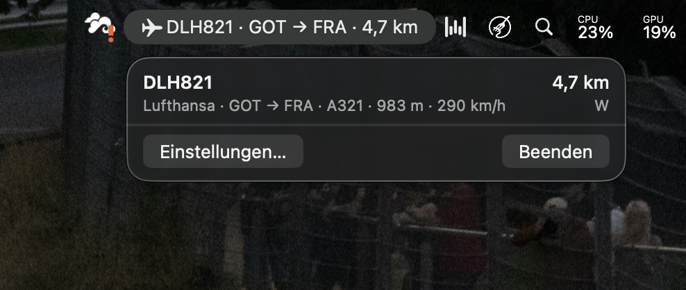
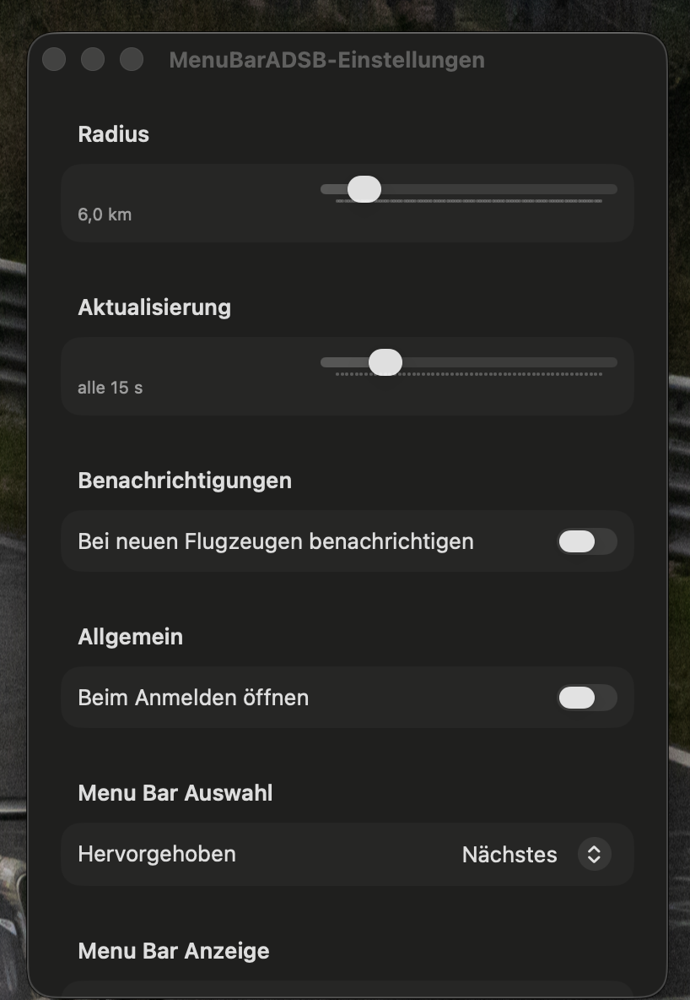
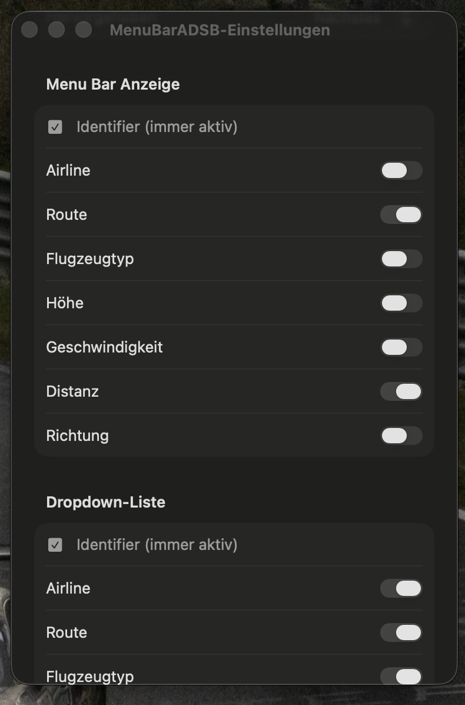

# MenuBarADSB

<p align="center">
  
</p>

<p align="center">
  A small macOS menu bar app that shows aircraft in your area in real time.
</p>

---

## What it does

MenuBarADSB lives in your menu bar and shows the closest (or highest / lowest / fastest) aircraft within a configurable radius around your current location. Click it to see the full list of nearby aircraft — identifier, airline, route, type, altitude, speed, distance, and heading. Clicking an aircraft opens it on Flightradar24 or the adsb.lol globe.

## Screenshots

<p align="center">
  
</p>

<p align="center">
  
  &nbsp;
  
</p>

## Features

- **Live tracking** within a 1–50 km radius, updating every 5–60 seconds
- **Configurable menu bar display** — pick which fields appear next to the identifier
- **Dropdown list** of all nearby aircraft, sorted by distance
- **"Featured" selection**: closest / highest altitude / lowest altitude / fastest
- **Notifications** for newly appearing aircraft (optional)
- **Launch at login** (`SMAppService`)
- **Localization**: English & German (follows system language)
- **Sandboxed**, signed with Hardened Runtime
- Pure SwiftUI, no external dependencies

## Data sources

The app fetches data **live** from two public APIs — nothing is stored locally:

| Data | Source |
|---|---|
| Aircraft positions (ICAO, position, altitude, speed, track) | [adsb.lol](https://www.adsb.lol) |
| Airline name & route (origin/destination IATA) by callsign | [adsbdb.com](https://www.adsbdb.com) |

Big thanks to the maintainers of both projects for offering these for free.

## Install

**Requirements:** macOS 26 or newer.

1. Grab the latest `MenuBarADSB-*.zip` from the [Releases page](https://github.com/RobinSp5/MacADSBMenuBar/releases/latest).
2. Unzip it and move `MenuBarADSB.app` to `/Applications`.
3. **First launch:** the app is unsigned (ad-hoc only — no Apple Developer ID), so macOS Gatekeeper blocks the default double-click. Right-click the app → **Open** → confirm the dialog. After that it launches normally.
4. macOS will ask for location permission — needed to determine the radius around your position.

## Build from source

**Requirements:**
- macOS 26 or newer
- Xcode 26 or newer

```bash
git clone https://github.com/RobinSp5/MacADSBMenuBar.git
cd MacADSBMenuBar
open MenuBarADSB.xcodeproj
```

Hit **Run** in Xcode (⌘R). On first launch macOS asks for location permission — needed to determine the radius around your position.

## Localization

The app uses String Catalogs (`Localizable.xcstrings`, `InfoPlist.xcstrings`) with English as the source language and German as a translation.

- macOS in **English** → app in English, numbers with a dot (e.g. `1.5 km`)
- macOS in **German** → app in German, numbers with a comma (e.g. `1,5 km`)
- Per-app language override via *System Settings → General → Language & Region → Applications*

To add another language: add the locale to `knownRegions` in `project.pbxproj`, add the language in the String Catalog, then provide translations.

## Project layout

```
MenuBarADSB/
├── MenuBarADSBApp.swift        // App entry, scene setup
├── Models/                      // Aircraft, DisplayField, MenuBarSelection, GeoMath
├── Services/                    // ADSBService, RouteService, LocationService,
│                                // NotificationService, LaunchAtLoginService
├── State/                       // AppSettings (UserDefaults), AircraftStore (polling)
├── Views/                       // MenuBarLabelView, MenuBarContentView, SettingsView
├── Localizable.xcstrings        // UI strings EN/DE
└── InfoPlist.xcstrings          // NSLocationUsageDescription EN/DE
```

## Ideas for later

- Watchlist / favourites (highlight callsign patterns)
- Manual location override
- Trend indicator (approaching / receding)
- Aircraft photos via Planespotters
- Inline map in the popover
- Pause / snooze
- Multiple zones (alert radius vs. display radius)

## License

No license set yet. Open an issue if you need one.

---

*Built for personal use. Not affiliated with adsb.lol or adsbdb.com.*
