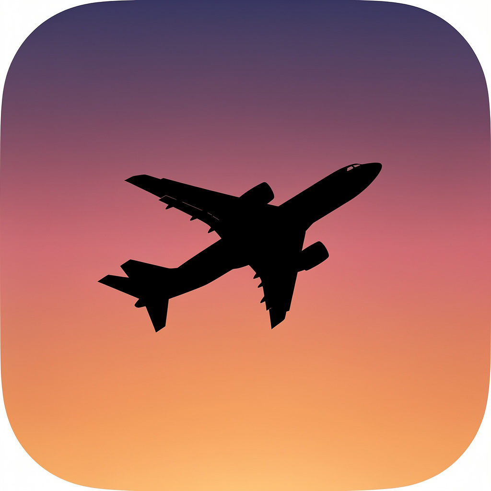

# MenuBarADSB

<p align="center">
  
</p>

<p align="center">
  Eine kleine macOS Menu Bar App, die Flugzeuge in deinem Umkreis live anzeigt.
</p>

---

## Was macht die App?

MenuBarADSB sitzt in deiner Menu Bar und zeigt das nächstgelegene (oder höchste / niedrigste / schnellste) Flugzeug in einem konfigurierbaren Radius um deinen aktuellen Standort an. Mit einem Klick siehst du eine Liste aller Flugzeuge in der Nähe — Identifier, Airline, Route, Flugzeugtyp, Höhe, Geschwindigkeit, Distanz und Richtung. Klick auf ein Flugzeug öffnet es auf Flightradar24 oder dem adsb.lol Globe.

## Features

- **Live‑Tracking** in einem Radius von 1–50 km, Update alle 5–60 Sekunden
- **Menu Bar Anzeige** frei konfigurierbar — wähle, welche Felder neben dem Identifier angezeigt werden
- **Dropdown‑Liste** mit allen Flugzeugen im Umkreis, sortiert nach Distanz
- **„Hervorgehoben" Auswahl**: Nächstes / Höchste Flughöhe / Niedrigste Flughöhe / Schnellstes
- **Benachrichtigungen** bei neu auftauchenden Flugzeugen (optional)
- **Beim Anmelden öffnen** (`SMAppService`)
- **Lokalisierung**: Deutsch & Englisch (folgt der System‑Sprache)
- **Sandboxed**, signiert mit Hardened Runtime
- Reine SwiftUI, keine externen Dependencies

## Datenquellen

Die App ruft Daten **live** von zwei öffentlichen APIs ab — es findet keine eigene Datenspeicherung statt:

| Daten | Quelle |
|---|---|
| Flugzeugpositionen (ICAO, Position, Höhe, Speed, Track) | [adsb.lol](https://www.adsb.lol) |
| Airline‑Name & Route (Origin/Destination IATA) per Callsign | [adsbdb.com](https://www.adsbdb.com) |

Großen Dank an die Betreiber beider Projekte für die kostenlose Verfügbarkeit.

## Build & Run

**Voraussetzungen:**
- macOS 26 oder neuer
- Xcode 26 oder neuer

```bash
git clone https://github.com/RobinSp5/MacADSBMenuBar.git
cd MacADSBMenuBar
open MenuBarADSB.xcodeproj
```

In Xcode auf **Run** drücken (⌘R). Beim ersten Start fragt macOS nach Standort‑Berechtigung — die wird benötigt, um den Radius um deine Position zu bestimmen.

## Lokalisierung

Die App nutzt String Catalogs (`Localizable.xcstrings`, `InfoPlist.xcstrings`) mit Englisch als Source‑Sprache und Deutsch als Übersetzung.

- macOS auf **Deutsch** → App in Deutsch, Zahlen mit Komma (z. B. `1,5 km`)
- macOS auf **Englisch** → App in Englisch, Zahlen mit Punkt (z. B. `1.5 km`)
- Per‑App‑Sprachwahl über *Systemeinstellungen → Allgemein → Sprache & Region → Apps*

Eine weitere Sprache hinzufügen: `de` zu `knownRegions` in `project.pbxproj` ergänzen, im String Catalog die neue Sprache anlegen, Übersetzungen einpflegen.

## Projektstruktur

```
MenuBarADSB/
├── MenuBarADSBApp.swift        // App Entry, Scene Setup
├── Models/                      // Aircraft, DisplayField, MenuBarSelection, GeoMath
├── Services/                    // ADSBService, RouteService, LocationService,
│                                // NotificationService, LaunchAtLoginService
├── State/                       // AppSettings (UserDefaults), AircraftStore (Polling)
├── Views/                       // MenuBarLabelView, MenuBarContentView, SettingsView
├── Localizable.xcstrings        // UI strings EN/DE
└── InfoPlist.xcstrings          // NSLocationUsageDescription EN/DE
```

## Ideen für später

- Watchlist / Favoriten (Callsign‑Patterns hervorheben)
- Manueller Standort‑Override
- Trend‑Indikator (nähert sich / entfernt sich)
- Flugzeug‑Foto via Planespotters
- Inline‑Map im Popover
- Pause / Snooze
- Mehrere Zonen (Alert‑Radius vs. Anzeige‑Radius)

## Lizenz

Aktuell keine Lizenz hinterlegt. Bei Bedarf gerne ein Issue aufmachen.

---

*Für persönliche Nutzung gebaut. Kein Affiliation mit adsb.lol oder adsbdb.com.*
